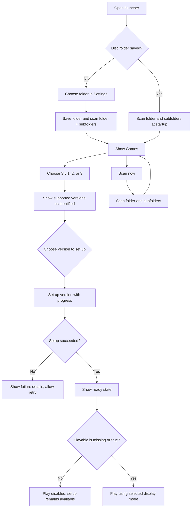

# Tauri launcher plan

## Goal

Build a desktop launcher for Sly Cooper 1, 2, and 3 with a Rust backend, a
Svelte frontend, and Tauri as the desktop shell. It helps users find their
own disc images, set up supported game versions, and launch games when their
native ports are ready.

The first packaging target is a Linux AppImage. Windows and macOS remain
planned platforms.

## Technology and responsibilities

- **Rust** owns disc scanning and recognition, setup operations, filesystem
  work, configuration, data-directory moves, and game process launching.
- **Svelte** renders the interface and handles navigation and user input.
- **Tauri commands** expose discrete operations to the frontend, such as
  reading configuration, selecting a folder, starting a scan, setting up a
  version, and launching a game.
- **Tauri events** report incremental scan results and setup progress so the
  interface can update as work happens.
- Keep game and filesystem rules in Rust; the frontend should not duplicate
  version recognition or setup logic.

## Main window

- A simple top navigation bar has **Games** and **Settings** tabs.
- There is no left sidebar.
- In **Games**, a second top row selects **Sly 1**, **Sly 2**, or **Sly 3**.
- The selected game's view uses a blurred background image with a readable
  foreground panel for setup and launch actions.
- Each game page shows found versions and their setup/play state. PAL and NTSC
  are distinct versions. The user can set up either or both.
- Settings and mods beyond basic launch options are out of scope for the first
  version.

## Disc discovery and setup

- The user chooses and saves a disc image folder in Settings.
- On startup, scan that folder and its subfolders. Also provide **Scan now**.
- Scan recursively and report each supported version to the Svelte UI as soon
  as it is recognized; do not wait for the full scan to finish.
- Each game's own decompilation defines its supported retail versions and
  recognition rules. Do not treat an image as valid only because of its
  extension or filename.
- Implement scanning and setup in Rust, using each game's version definitions
  as the source of truth. Do not require Python at runtime.
- Let the user choose any supported version to set up, including multiple
  versions of the same game.
- Show setup progress, completion, and useful failure information. Setup must
  remain available when launching is disabled.
- If no supported images are found, show: **No valid disc images found.**

For Sly 1, the current decompilation identifies retail versions by inspecting
which executable the disc boots and comparing that executable's SHA-1 against
its version data. It accepts `.iso`, `.img`, and `.bin`; image names do not
matter. The recognized prototype is not an installable version. Keep the Rust
implementation aligned with the Sly 1 project's maintained definitions and
rules. Sly 2 and Sly 3 should use their own project definitions when available.

## Data and configuration

Use each platform's standard per-user application data location as the
OpenThievius data root. On Linux this is `~/.local/share/openthievius`.
Windows and macOS should use their corresponding standard application support
locations.

Keep launcher configuration and launcher-specific files in this root. Keep
each game's data and saves separate:

```text
<OpenThievius data directory>/
├── config.*
├── launcher files…
├── sly1/
│   ├── game files…
│   └── saves/
├── sly2/
│   ├── game files…
│   └── saves/
└── sly3/
    ├── game files…
    └── saves/
```

If the user changes the data directory, copy its contents to the new location,
verify the copy, and remove the old directory only after the copy succeeds. If
copying or verification fails, preserve the original data.

A user-editable launcher configuration holds per-game playability values:

- If a game's `playable` value is missing or `true`, allow **Play** when that
  game is set up.
- If it is `false`, disable **Play**, while still allowing setup.
- Setup state and playability are separate: a game can be set up while its
  native port is not ready.

The exact configuration format remains to be chosen.

## Launch options

Provide a per-game display mode: **Windowed** or **Borderless fullscreen**.
Use a predetermined default window size; users can resize the window
manually. Mods and broader game settings are future work.

## User flow



## First release scope

- Rust + Tauri backend and Svelte user interface.
- Games and Settings navigation, game selectors, scan results, setup progress,
  and launch state.
- Recursive disc scanning, version selection, and Rust setup path.
- Per-game data and save directories and editable playability configuration.
- Windowed and borderless fullscreen launch options.
- Linux AppImage packaging.

## Migration from the GPUI implementation

The repository currently has a GPUI launcher under `launcher/`. Treat this
plan as the direction for the replacement UI. Inspect and reuse suitable Rust
backend logic only after confirming it matches this plan and the game projects'
current definitions. Replace the GPUI shell and UI with Tauri and Svelte; do
not maintain both desktop frontends as separate products.

## Deferred or open implementation details

- Exact config file format and schema.
- Exact predetermined window size.
- The setup steps and progress stages required by each game project.
- Error wording and recovery options for failed setup and data-directory moves.
- Windows and macOS packaging and platform-specific launch integration.
- Settings or mod support beyond the display mode above.

## Project constraints

Follow the repository's sourcing policy and project layout. The launcher must
not include or distribute disc images, executables, extracted game data, or
other proprietary material. Keep supported-version data aligned with each
game's project definitions.
